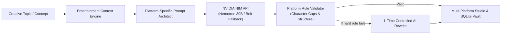

# AI-Powered Smart Multi-Platform Content Generator

A production-grade, full-stack Generative AI web application tailored for the **Entertainment Domain**. It takes a single creative topic or story concept and uses deep platform psychology, prompt architecture, and **NVIDIA NIM LLMs** (`nvidia/nemotron-3.5-lightning-30b-a3b`) to synthesize unique, native, format-compliant assets across **6 major platforms**: **Instagram, YouTube, YouTube Shorts, Facebook, X (formerly Twitter), and LinkedIn**.

---

## 🌟 Core Concept: One Topic → Multiple Native Assets



Rather than copying identical generic text across channels, each platform engine applies distinct algorithmic rules, formatting standards, and audience expectations:

1. **Instagram**: Visual curiosity hooks, aesthetic emoji spacing, Reel scripts, carousel layouts, and targeted entertainment hashtags.
2. **YouTube**: High-CTR curiosity-gap titles (<70 characters), full video scripts with structured scene breakdowns (`[00:00 - Hook]`), and SEO-rich descriptions.
3. **YouTube Shorts**: Explosive 3-second visual/verbal retention hooks, rapid-fire vertical pacing, sound effect indicators (`[Bass Drop]`), and seamless loop endings.
4. **Facebook**: Community discussion starters, emotive relatable storytelling, and shareable conversational prompts.
5. **X (Twitter)**: High-impact single posts respecting strict 280-character limits, or numbered multi-tweet threads (`1/`, `2/`) with punchy hooks.
6. **LinkedIn**: Transforming entertainment and film production concepts into creative leadership lessons, industry breakdowns, and career insights.

---

## 🛠️ Technology Stack

| Layer | Technology | Purpose |
| :--- | :--- | :--- |
| **Frontend** | React 18, Vite 5 | High-speed SPA rendering and modular component architecture |
| **Styling** | Tailwind CSS 3 | Modern dark navy/purple entertainment-industry aesthetic |
| **Icons** | Lucide React & Custom SVG | Pixel-perfect vector platform and action icons |
| **Backend** | Python 3.14 / FastAPI | High-performance async REST API with Pydantic validation |
| **AI Provider** | NVIDIA NIM API | Hosted NVIDIA Nemotron LLM inference |
| **Primary Model** | `nvidia/nemotron-3.5-lightning-30b-a3b` | 30B parameter high-creativity entertainment model |
| **Fallback Model**| `nvidia/nemotron-3.5-bolt-e4b` | Fast-inference resilient secondary model |
| **AI SDK** | OpenAI Python SDK | Standardized client configured with NVIDIA's Base URL |
| **Database** | SQLite + SQLAlchemy | Automated schema creation, history persistence, and retrieval |
| **Validation** | Custom Python Engine | Word/character counts, platform cap checks, and required sections |
| **HTTP Client** | Axios | Frontend-to-backend REST API communication |

---

## 📂 Project Structure

```
genAI mini project/
├── backend/
│   ├── main.py                 # FastAPI application, CORS, and REST endpoints
│   ├── nvidia_service.py       # NVIDIA NIM client with primary/fallback models
│   ├── prompt_builder.py       # Multi-platform prompt architecture & system instructions
│   ├── content_generator.py    # Orchestration, parsing, and controlled AI rewrites
│   ├── platform_config.py      # Character limits, hashtag caps, and platform rules
│   ├── validator.py            # Word/character counting and constraint verification
│   ├── models.py               # SQLAlchemy SQLite database models
│   ├── database.py             # SQLite connection and session management
│   ├── history_service.py      # CRUD operations for generation history
│   ├── schemas.py              # Pydantic request and response schemas
│   ├── test_app.py             # Comprehensive automated test suite
│   ├── requirements.txt        # Backend dependencies
│   ├── .env.example            # Backend environment template
│   └── .env                    # Active backend environment configuration
├── frontend/
│   ├── src/
│   │   ├── components/
│   │   │   ├── Navbar.jsx        # Navigation bar with NVIDIA health status badge
│   │   │   ├── LandingPage.jsx   # Hero section, feature overview, and sample comparison
│   │   │   ├── GeneratorForm.jsx # Creative brief configuration engine
│   │   │   ├── ResultsView.jsx   # Multi-platform outputs, download, and copy controls
│   │   │   ├── PlatformCard.jsx  # Individual platform output card, editor, & AI modifier
│   │   │   ├── HistoryVault.jsx  # SQLite generation history viewer and search
│   │   │   └── SocialIcons.jsx   # Custom SVG icons for Instagram, YouTube, X, etc.
│   │   ├── services/
│   │   │   └── api.js            # Axios client functions for FastAPI endpoints
│   │   ├── App.jsx               # Main state controller and tab manager
│   │   ├── main.jsx              # React DOM entry point
│   │   └── index.css             # Tailwind CSS directives and custom styling
│   ├── package.json              # Frontend package configuration
│   ├── vite.config.js            # Vite bundler configuration
│   ├── tailwind.config.js        # Tailwind styling configuration
│   └── postcss.config.js         # PostCSS configuration
├── start_backend.bat             # 1-click Windows backend launcher
├── start_frontend.bat            # 1-click Windows frontend launcher
└── README.md                     # Comprehensive documentation
```

---

## 🚀 Getting Started

### 1. Prerequisites
- **Python 3.10+** (Python 3.11/3.14 verified)
- **Node.js 18+** or **20+** and **npm**

### 2. Backend Setup
1. Navigate into the `backend/` directory:
   ```bash
   cd backend
   ```
2. Create and activate a virtual environment (optional but recommended):
   ```bash
   python -m venv venv
   # On Windows:
   venv\Scripts\activate
   # On Linux/macOS:
   source venv/bin/activate
   ```
3. Install required Python packages:
   ```bash
   pip install -r requirements.txt
   ```
4. Configure your `.env` file (copy from `.env.example`):
   ```ini
   NVIDIA_API_KEY=your_nvidia_api_key_here
   NVIDIA_BASE_URL=https://integrate.api.nvidia.com/v1
   NVIDIA_MODEL=nvidia/nemotron-3.5-lightning-30b-a3b
   NVIDIA_FALLBACK_MODEL=nvidia/nemotron-3.5-bolt-e4b
   DATABASE_URL=sqlite:///./content_generator.db
   CORS_ORIGINS=http://localhost:5173,http://127.0.0.1:5173
   ```
   > **Note on NVIDIA API Key**: Get a free API key from [NVIDIA Build](https://build.nvidia.com/). If the key is not set or empty, the application provides structured guidance and demonstration previews without crashing.

5. Start the backend server:
   ```bash
   python main.py
   ```
   Backend will run on: `http://127.0.0.1:8000` (API documentation available at `http://127.0.0.1:8000/docs`).

### 3. Frontend Setup
1. Navigate into the `frontend/` directory:
   ```bash
   cd ../frontend
   ```
2. Install frontend dependencies:
   ```bash
   npm install
   ```
3. Start the development server:
   ```bash
   npm run dev
   ```
4. Open your browser and navigate to:
   ```
   http://localhost:5173
   ```

---

## 🧪 Testing and Verification

The backend includes an automated test suite covering:
- Health check and runtime configuration.
- Word and character counting mechanics.
- Platform constraints (e.g., standard single-tweet X 280-char limit enforcement).
- Multi-platform generation and prompt assembly.
- Language and tone flexibility (Hindi, Hinglish, English, Funny, Suspense).
- Full end-to-end SQLite history creation, retrieval, and deletion.

To run the tests:
```bash
cd backend
python -m pytest test_app.py -v
```

---

## 🛡️ Responsible AI Disclaimers
- **No Guaranteed Virality**: Content is algorithm-friendly and formatted natively, but genuine social media reach depends on distribution, timing, and audience engagement.
- **Human in the Loop**: The application generates drafts for review and editing; it does not automatically publish to user accounts.
- **Proprietary Algorithms**: The tool does not claim access to proprietary social platform algorithms.

